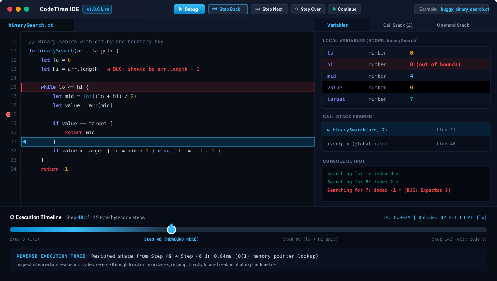

# CodeTime

> A programming language with a bytecode VM, a time-travel debugger, and a browser IDE, written in TypeScript.

🌐 **[Try the Live IDE →](https://aum-mangal.github.io/codetime/)**

[](https://github.com/Aum-Mangal/codetime/actions/workflows/ci.yml)
[](https://github.com/Aum-Mangal/codetime/actions/workflows/deploy.yml)
[](https://aum-mangal.github.io/codetime/)
[](https://www.typescriptlang.org/)
[](LICENSE)

---

## 📸 Visual Time-Travel IDE in Action



> *Illustration of the IDE layout.* Open the [live IDE](https://aum-mangal.github.io/codetime/) and pick **Buggy Binary Search** to try the real thing: run it, then step backward from a wrong `-1` result to find the off-by-one in the loop condition.

---

## ⚡ Performance Benchmarks

Measured with `npm run bench` on a single ~25-line program (recursive Fibonacci plus a bubble sort of 10 numbers). These are micro-benchmarks of each stage, not a comparison against other languages. Results vary by up to ~50% between runs on the same laptop, so treat them as rough orders of magnitude:

| Pipeline Stage / Component | Sample Size | Throughput | Latency / Speed |
|---|---|---|---|
| **Lexer Tokenization** | 2,000 runs | **25,000+ ops/sec** | ~0.04 ms / run |
| **Parser AST Generation** | 2,000 runs | **11,500+ ops/sec** | ~0.08 ms / run |
| **Semantic Scope Analysis** | 2,000 runs | **150,000+ ops/sec** | ~0.006 ms / run |
| **Bytecode Compilation** | 2,000 runs | **95,000+ ops/sec** | ~0.01 ms / run |
| **VM Execution (Full Program)** | 1,000 runs | **7,500+ runs/sec** | ~0.13 ms / run |
| **Time-Travel Recording** | 100 runs | **1,700,000+ steps/sec** | ~0.0006 ms / step |

The debugger has its own benchmark (`npm run bench:replay`) for a loop that pushes N items into an array. These are the numbers before and after the checkpoint + replay rewrite:

| Items pushed | Steps | Snapshot per step (v1.1) | Checkpoint + replay | Seek to any step (p99) |
|---:|---:|---:|---:|---:|
| 500 | 9,016 | 146 ms, 41 MB | 19 ms, 0.5 MB | 1.8 ms |
| 5,000 | 90,016 | 12.6 s, 3.1 GB | 89 ms, 1.9 MB | 1.6 ms |
| 20,000 | 360,016 | over the step cap | 270 ms, 14.1 MB | 5.3 ms |

---

## 🌟 Overview

**CodeTime** is a programming language and developer environment designed from the ground up to make debugging intuitive, visual, and non-destructive.

In most everyday debugging you can only step forward: step past the interesting moment and you have to restart. Reverse debugging exists in tools like gdb (`reverse-step`), rr and WinDbg TTD, but it usually needs special setup. CodeTime builds it into the language:
- The debugger records a run once, on the same VM the CLI uses, then lets you move through it in both directions.
- Step by instruction or by line (into, over, out) forward **and backward**, and run back to the previous breakpoint.
- Breakpoints can have conditions (`lo == hi`); a condition is evaluated on a copy of the program state, so it cannot change the run.
- Ask "when did this variable last change?" and jump straight to that step, including changes through `arr[i] = x` or `arr.push(x)`.
- Variables, captured variables, call stack frames and the operand stack are shown for whichever step you are on.

The project is structured as a TypeScript monorepo featuring a full compiler pipeline, a bytecode virtual machine, a command-line interface (CLI), and a modern browser-based IDE powered by Monaco Editor and Web Workers.

🌐 **Try it in your browser:** [https://aum-mangal.github.io/codetime/](https://aum-mangal.github.io/codetime/)

---

## 🏗️ How I Built This (Key Engineering Decisions)

The bytecode design (opcodes, call frames, open/closed upvalues for closures) follows the clox VM from Robert Nystrom's [*Crafting Interpreters*](https://craftinginterpreters.com/). The time-travel debugger, structs, default parameters, error recovery and the IDE are CodeTime's own.

### 1. Precedence climbing for expressions
Binary operators are parsed with precedence climbing (the binary-operator core of a Pratt parser): each operator has a binding power, and one loop handles every precedence level instead of one function per level. Precedence follows Python: `**` binds tighter than unary minus (`-2 ** 2` is `-4`), and `not` binds looser than comparisons (`not a == b` is `not (a == b)`). The parser recovers from syntax errors, so one pass reports every error.

### 2. A bytecode VM instead of a tree-walking interpreter
The compiler turns the AST into a flat array of opcodes in a single pass, and the VM runs them in one dispatch loop over an operand stack. Bytecode gives the debugger a natural unit of execution (one instruction = one step) and an instruction pointer to record. I have not benchmarked it against a tree-walking interpreter, so I make no speed claim here.

### 3. Record and replay with checkpoints for time travel
Many opcodes destroy information (an assignment overwrites the old value), so you cannot simply run instructions backward. The first version stored a full snapshot of program state after every instruction: seeking was O(1), but a 90,000-step program needed 3.1 GB.

The debugger now works like rr. It drives the real, resumable VM one `step()` at a time and keeps:
- a 20-byte-per-step event log in typed arrays (line, call depth, event kind, variable written);
- a full, identity-preserving copy of the VM state every 1,000 steps.

To show step n, it restores the nearest checkpoint and re-executes the gap. The VM is deterministic, so the result is exact; a test compares every step against a run with no checkpoints. Line stepping, reverse stepping, breakpoints and watchpoints are scans of the event log, so only the step finally shown is replayed. The trade-off: seeking costs up to 1,000 instructions (about 2 ms) instead of O(1), in exchange for over 1,000× less memory.

### 4. Debug info for variable names
Stack slots are reused by sibling blocks, so a slot number does not identify a variable. The compiler records each local's live range (first and last instruction it occupies its slot), similar in spirit to DWARF location lists. The debugger shows a local only inside its range, under its own name.

---

## ✨ Features & Architecture

- **Full Compiler Pipeline**:
  - **Lexer**: Deterministic tokenizer tracking source coordinates (line, column spans).
  - **Pratt Parser**: Operator precedence parser supporting expressions, statements, and blocks.
  - **Semantic Analyzer**: Scope resolution, arity checks for functions and structs, loop/function context checks, and shadowing warnings.
  - **Bytecode Compiler**: Single-pass code generator emitting bytecode chunks, constant pools, and line maps.
  - **Virtual Machine**: Stack-based execution engine with call frames, closures, an instruction budget, and runtime type checks.
- **Time-Travel Debugger Engine** (record and replay, see [docs/DEBUGGER.md](docs/DEBUGGER.md)):
  - `stepInto` / `stepOver` / `stepOut` and `reverseStepInto` / `reverseStepOver` / `reverseStepOut`: line-level stepping in both directions.
  - `continueToBreakpoint` / `reverseContinue`: run to the next or previous breakpoint hit; breakpoints may have conditions.
  - `findChange(name, direction)`: jump to the step that last (or next) wrote a variable.
  - `stepForward` / `stepBackward` / `gotoStep`: instruction-level movement.
  - Bounded memory: 20 bytes per step plus at most 200 checkpoints; very long runs are marked as truncated instead of silently cut off.
- **Browser IDE (`packages/ide`)**:
  - **Monaco Editor** with custom Monarch syntax highlighting and theme.
  - Background **Web Worker** execution thread so the UI remains completely fluid and responsive.
  - Forward and reverse stepping controls with VS Code-style shortcuts (Shift reverses direction).
  - Conditional breakpoints (right-click a breakpoint) and a "last change" button on every variable.
  - **Execution Timeline Panel** showing the events around the current step and the recording's size.
  - Live inspection panels for **Variables**, **Call Stack**, and **Operand Stack**.
  - Typed worker protocol; each message carries one step's state, never the whole run.
- **Developer CLI (`packages/cli`)**:
  - `codetime run <file>` — Run CodeTime source files.
  - `codetime tokens <file>` — Inspect lexer token stream.
  - `codetime ast <file>` — Visualize Abstract Syntax Tree.
  - `codetime compile <file>` — Disassemble bytecode instructions.
  - `codetime eval "<code>"` — Evaluate code snippets interactively.
- **Automated Verification**:
  - 285 unit, integration and regression tests (Vitest), run in CI on Linux and Windows with Node 20 and 22, including a differential test that compares replayed state with an uncheckpointed run at every step.

---

## 🚀 Quick Start

### Prerequisites

- **Node.js** ≥ 20.0.0
- **npm** ≥ 9.0.0

### Installation & Build

```bash
# Clone repository
git clone https://github.com/Aum-Mangal/codetime.git
cd codetime

# Install dependencies and build all monorepo packages
npm install
npm run build

# Run full test suite (285 tests across 8 test files)
npm test

# Run performance benchmarks
npm run bench
```

### CLI Usage

```bash
# Execute CodeTime programs
node packages/cli/dist/index.js run examples/fibonacci.ct

# Inspect token stream
node packages/cli/dist/index.js tokens examples/hello.ct

# Visualize Abstract Syntax Tree (AST)
node packages/cli/dist/index.js ast examples/hello.ct

# Disassemble bytecode
node packages/cli/dist/index.js compile examples/fibonacci.ct

# Evaluate code snippet
node packages/cli/dist/index.js eval "let a = 15; let b = 25; print(a * b)"
```

### Launch the Web IDE Locally

```bash
cd packages/ide
npm run dev
# Open http://localhost:5173
```

---

## 💻 Language Syntax & Capabilities

```codetime
// Fibonacci sequence in CodeTime
fn fibonacci(n) {
    if n <= 1 {
        return n
    }
    return fibonacci(n - 1) + fibonacci(n - 2)
}

let i = 0
while i <= 8 {
    print("fib(" + str(i) + ") = " + str(fibonacci(i)))
    i += 1
}
```

Detailed language documentation:
- [`docs/LANGUAGE_SPEC.md`](docs/LANGUAGE_SPEC.md) — Formal grammar & language specification
- [`docs/TUTORIAL.md`](docs/TUTORIAL.md) — Step-by-step language tutorial and examples
- [`docs/ARCHITECTURE.md`](docs/ARCHITECTURE.md) — Compiler architecture and VM bytecode design
- [`docs/DEBUGGER.md`](docs/DEBUGGER.md) — Time-travel debugger implementation details

---

## 📁 Repository Structure

```
codetime/
├── packages/
│   ├── compiler/         Language compiler, VM engine & Debugger (pure TypeScript)
│   │   ├── src/
│   │   │   ├── lexer/       Tokenization & coordinate tracking
│   │   │   ├── parser/      Recursive-descent parser with precedence climbing
│   │   │   ├── ast/         AST node definitions & AST visualizer
│   │   │   ├── semantic/    Scope hierarchy & semantic verification
│   │   │   ├── codegen/     Bytecode compiler & disassembler
│   │   │   ├── vm/          Stack Virtual Machine runtime
│   │   │   └── debugger/    Record-and-replay debugger: trace, checkpoints, navigation
│   │   ├── tests/           Vitest unit, integration & regression suites (285 tests)
│   │   └── benchmarks/      Throughput benchmark suite
│   ├── cli/              Node.js CLI executable tool (codetime)
│   └── ide/              React + Vite + Monaco + Web Worker Visual Time-Travel IDE
├── examples/             Curated sample programs (.ct)
├── docs/                 Language specifications, architecture diagrams, and debugger docs
├── assets/               Visual previews and diagrams
└── .github/workflows/    CI test workflow and automated GitHub Pages deployment
```

---

## 📄 License

This project is open-source under the [MIT License](LICENSE).
