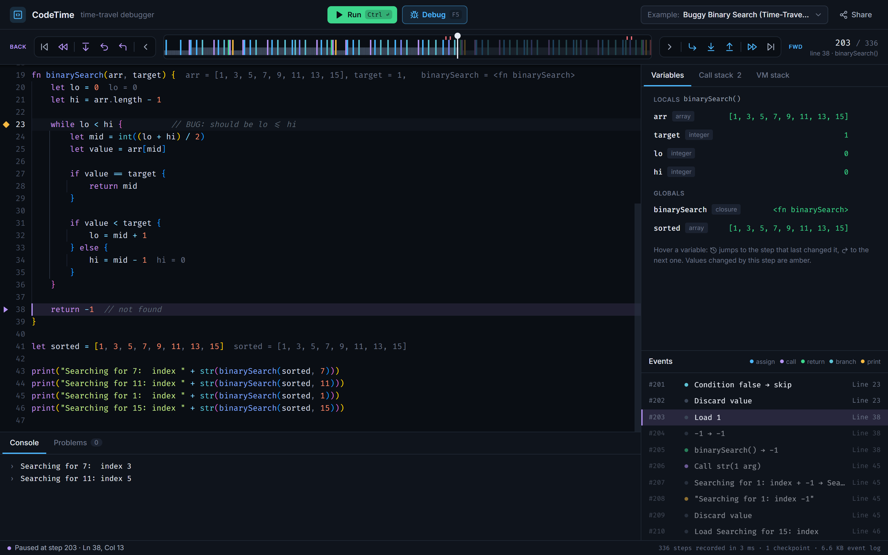

# CodeTime

> A programming language with a bytecode VM, a time-travel debugger, and a browser IDE, written in TypeScript.

🌐 **[Try the Live IDE →](https://aum-mangal.github.io/codetime/)**

[](https://github.com/Aum-Mangal/codetime/actions/workflows/ci.yml)
[](https://github.com/Aum-Mangal/codetime/actions/workflows/deploy.yml)
[](https://aum-mangal.github.io/codetime/)
[](https://www.typescriptlang.org/)
[](LICENSE)

---

## 📸 The IDE



*A real screenshot of the production build.* The **Buggy Binary Search** example is paused after stepping **backward** from its wrong `-1` result into the call that produced it.
- Gutter: the amber diamond on line 23 is a conditional breakpoint (`lo == hi`).
- Inline values: grey text shows each variable's current value, on the line that last wrote it.
- Run scrubber (top): the whole 336-step recording, colored by event kind. Calls show as raised plateaus, and red ticks mark where the breakpoint stops.

[Try it live](https://aum-mangal.github.io/codetime/): press **Debug**, then **Go to last step**, then **Reverse step over** and **Reverse step into**. You land where `lo == hi`, one candidate left unchecked: the off-by-one in `while lo < hi`.

---

## ⚡ Performance

Measured with `npm run bench` and `npm run bench:replay` on the development machine (Node 24, Intel i5-11320H). CI runs both on every push and attaches the results as an artifact.

**Three realistic programs** (tinybench means; seek latency is over 300 random jumps):

| Program | VM steps | Compile | Plain VM run | Record with debugger | Event log | Seek to any step (p50 / p99) |
|---|---:|---:|---:|---:|---:|---:|
| fib(20), recursive | 262,696 | 28 µs | 5.4 ms | 157 ms | 5.0 MB | 0.66 / 2.2 ms |
| insertion sort, 200 items | 297,697 | 93 µs | 5.8 ms | 186 ms | 5.7 MB | 0.62 / 2.0 ms |
| closures + arrays, 10k iterations | 300,290 | 71 µs | 6.5 ms | 191 ms | 5.7 MB | 0.75 / 2.3 ms |

The plain VM runs about 50 million instructions per second. Recording is about 30 times slower (about 1.6 million steps per second), because it steps the VM one instruction at a time and writes an event log entry for each step. That is the cost of being able to travel backward.

**Against the previous design** (a full copy of the VM state after every step), on a loop that pushes N items into an array:

| Items pushed | Steps | Copy per step: record, memory | Checkpoint + replay: record, memory | Seek p99 |
|---:|---:|---:|---:|---:|
| 500 | 9,016 | 65 ms, 26.1 MB | 17 ms, under 0.5 MB | 2.6 ms |
| 2,000 | 36,016 | 479 ms, 310.6 MB | 55 ms, 0.3 MB | 2.3 ms |
| 20,000 | 360,016 | not feasible | 309 ms, 14.1 MB | 4.9 ms |

---

## 🌟 Overview

**CodeTime** is a programming language and developer environment designed from the ground up to make debugging intuitive, visual, and non-destructive.

In most everyday debugging you can only step forward: step past the interesting moment and you have to restart. Reverse debugging exists in tools like gdb (`reverse-step`), rr and WinDbg TTD, but it usually needs special setup. CodeTime builds it into the language:
- The debugger records a run once, on the same VM the CLI uses, then lets you move through it in both directions.
- Step by instruction or by line (into, over, out) forward **and backward**, and run back to the previous breakpoint.
- Breakpoints can have conditions (`lo == hi`); a condition is evaluated on a copy of the program state, so it cannot change the run.
- Ask "when did this variable last change?" and jump straight to that step, including changes through `arr[i] = x` or `arr.push(x)`.
- Variables, captured variables, call stack frames and the operand stack are shown for whichever step you are on.

The project is structured as a TypeScript monorepo featuring a full compiler pipeline, a bytecode virtual machine, a command-line interface (CLI), and a modern browser-based IDE powered by Monaco Editor and Web Workers.

🌐 **Try it in your browser:** [https://aum-mangal.github.io/codetime/](https://aum-mangal.github.io/codetime/)

---

## 🏗️ How I Built This (Key Engineering Decisions)

The main decisions are written up as architecture decision records in [docs/adr](docs/adr/README.md), each with the alternatives considered and what it costs.

The bytecode design (opcodes, call frames, open/closed upvalues for closures) follows the clox VM from Robert Nystrom's [*Crafting Interpreters*](https://craftinginterpreters.com/). The time-travel debugger, structs, default parameters, error recovery and the IDE are CodeTime's own.

### 1. Precedence climbing for expressions
Binary operators are parsed with precedence climbing (the binary-operator core of a Pratt parser): each operator has a binding power, and one loop handles every precedence level instead of one function per level. Precedence follows Python: `**` binds tighter than unary minus (`-2 ** 2` is `-4`), and `not` binds looser than comparisons (`not a == b` is `not (a == b)`). The parser recovers from syntax errors, so one pass reports every error.

### 2. A bytecode VM instead of a tree-walking interpreter
The compiler turns the AST into a flat array of opcodes in a single pass, and the VM runs them in one dispatch loop over an operand stack. Bytecode gives the debugger a natural unit of execution (one instruction = one step) and an instruction pointer to record. I have not benchmarked it against a tree-walking interpreter, so I make no speed claim here.

### 3. Record and replay with checkpoints for time travel
Many opcodes destroy information (an assignment overwrites the old value), so you cannot simply run instructions backward. The first version stored a full snapshot of program state after every instruction: seeking was O(1), but a 90,000-step program needed 3.1 GB.

The debugger now works like rr. It drives the real, resumable VM one `step()` at a time and keeps:
- a 20-byte-per-step event log in typed arrays (line, call depth, event kind, variable written);
- a full, identity-preserving copy of the VM state every 1,000 steps.

To show step n, it restores the nearest checkpoint and re-executes the gap. The VM is deterministic, so the result is exact; a test compares every step against a run with no checkpoints. Line stepping, reverse stepping, breakpoints and watchpoints are scans of the event log, so only the step finally shown is replayed. The trade-off: seeking costs up to 1,000 instructions (about 2 ms) instead of O(1), in exchange for over 1,000× less memory.

### 4. Debug info for variable names
Stack slots are reused by sibling blocks, so a slot number does not identify a variable. The compiler records each local's live range (first and last instruction it occupies its slot), similar in spirit to DWARF location lists. The debugger shows a local only inside its range, under its own name.

---

## ✨ Features & Architecture

- **Full Compiler Pipeline**:
  - **Lexer**: Deterministic tokenizer tracking source coordinates (line, column spans).
  - **Pratt Parser**: Operator precedence parser supporting expressions, statements, and blocks.
  - **Semantic Analyzer**: Scope resolution, arity checks for functions and structs, loop/function context checks, and shadowing warnings.
  - **Bytecode Compiler**: Single-pass code generator emitting bytecode chunks, constant pools, and line maps.
  - **Virtual Machine**: Stack-based execution engine with call frames, closures, an instruction budget, and runtime type checks.
- **Time-Travel Debugger Engine** (record and replay, see [docs/DEBUGGER.md](docs/DEBUGGER.md)):
  - `stepInto` / `stepOver` / `stepOut` and `reverseStepInto` / `reverseStepOver` / `reverseStepOut`: line-level stepping in both directions.
  - `continueToBreakpoint` / `reverseContinue`: run to the next or previous breakpoint hit; breakpoints may have conditions.
  - `findChange(name, direction)`: jump to the step that last (or next) wrote a variable.
  - `stepForward` / `stepBackward` / `gotoStep`: instruction-level movement.
  - Bounded memory: 20 bytes per step plus at most 200 checkpoints; very long runs are marked as truncated instead of silently cut off.
- **Browser IDE (`packages/ide`)**:
  - **Run scrubber**: a canvas minimap of the whole recording (event kind by color, call depth by height, breakpoint stops as ticks). Click, drag or use the arrow keys to travel to any step.
  - **Monaco Editor** with a Monarch tokenizer, theme and completions for CodeTime, and **live diagnostics** (compiled in the worker while you type) shown as squiggles and in a Problems tab.
  - **Inline values** on the line where each variable was last written, and **hover** to see a variable's value and the step that last changed it.
  - Forward and reverse stepping controls with VS Code-style shortcuts (Shift reverses direction).
  - Conditional breakpoints edited in a gutter popover (right-click the gutter), and a "last change" button on every variable.
  - **Shareable links**: the program is compressed into the URL fragment; nothing is uploaded.
  - Inspector tabs for **Variables**, **Call Stack** and the **VM operand stack**, plus a list of the events around the current step.
  - Background **Web Worker**; a typed protocol where each message carries one step's state and a fixed-size overview, never the whole run.
  - Layout designed in Figma first; the CSS design tokens match the Figma variables one-to-one. Works down to phone width.
- **Developer CLI (`packages/cli`)**:
  - `codetime run <file>` — Run CodeTime source files.
  - `codetime tokens <file>` — Inspect lexer token stream.
  - `codetime ast <file>` — Visualize Abstract Syntax Tree.
  - `codetime compile <file>` — Disassemble bytecode instructions.
  - `codetime eval "<code>"` — Evaluate code snippets interactively.
- **Automated Verification**:
  - 326 Vitest tests, run in CI on Linux and Windows with Node 20 and 22. Line coverage of the compiler package is 95.7%, and CI fails below 94%.
  - **Property-based differential fuzzing** ([fast-check](https://fast-check.dev/)). Random well-formed programs, with closures, default parameters, nested loops, block locals, array mutation and occasional runtime errors, must give the same output and the same error on the VM and through the replay debugger. Replayed state must match at random steps, and arbitrary or truncated source must never crash the toolchain with a raw JavaScript exception. Shrinking reduces a failure to a minimal program.
  - **Golden-output tests**: every `examples/*.ct` has a checked-in `.expected` file, compared against the VM, the replay debugger, and the built `codetime` CLI.
  - **End-to-end tests** ([Playwright](https://playwright.dev/), Chrome) against the production build, covering the reverse-stepping demo, the "last change" watchpoint, breakpoints (plain and conditional, set in the gutter popover), the run scrubber by mouse and keyboard, hover values, live diagnostics, share links, and a run that hits the step limit.

---

## 🚀 Quick Start

### Prerequisites

- **Node.js** ≥ 20.0.0
- **npm** ≥ 9.0.0

### Installation & Build

```bash
# Clone repository
git clone https://github.com/Aum-Mangal/codetime.git
cd codetime

# Install dependencies and build all monorepo packages
npm install
npm run build

# Run the test suite (unit, regression, golden, property-based)
npm test

# Coverage report with thresholds, golden output through the CLI,
# and browser end-to-end tests (needs Google Chrome installed)
npm run test:coverage
npm run test:golden
npm run test:e2e

# Run performance benchmarks
npm run bench
```

### CLI Usage

```bash
# Execute CodeTime programs
node packages/cli/dist/index.js run examples/fibonacci.ct

# Inspect token stream
node packages/cli/dist/index.js tokens examples/hello.ct

# Visualize Abstract Syntax Tree (AST)
node packages/cli/dist/index.js ast examples/hello.ct

# Disassemble bytecode
node packages/cli/dist/index.js compile examples/fibonacci.ct

# Evaluate code snippet
node packages/cli/dist/index.js eval "let a = 15; let b = 25; print(a * b)"
```

### Launch the Web IDE Locally

```bash
cd packages/ide
npm run dev
# Open http://localhost:5173
```

---

## 💻 Language Syntax & Capabilities

```codetime
// Fibonacci sequence in CodeTime
fn fibonacci(n) {
    if n <= 1 {
        return n
    }
    return fibonacci(n - 1) + fibonacci(n - 2)
}

let i = 0
while i <= 8 {
    print("fib(" + str(i) + ") = " + str(fibonacci(i)))
    i += 1
}
```

Detailed language documentation:
- [`docs/LANGUAGE_SPEC.md`](docs/LANGUAGE_SPEC.md) — Formal grammar & language specification
- [`docs/TUTORIAL.md`](docs/TUTORIAL.md) — Step-by-step language tutorial and examples
- [`docs/ARCHITECTURE.md`](docs/ARCHITECTURE.md) — Compiler architecture and VM bytecode design
- [`docs/DEBUGGER.md`](docs/DEBUGGER.md) — Time-travel debugger implementation details

---

## 📁 Repository Structure

```
codetime/
├── packages/
│   ├── compiler/         Language compiler, VM engine & Debugger (pure TypeScript)
│   │   ├── src/
│   │   │   ├── lexer/       Tokenization & coordinate tracking
│   │   │   ├── parser/      Recursive-descent parser with precedence climbing
│   │   │   ├── ast/         AST node definitions & AST visualizer
│   │   │   ├── semantic/    Scope hierarchy & semantic verification
│   │   │   ├── codegen/     Bytecode compiler & disassembler
│   │   │   ├── vm/          Stack Virtual Machine runtime
│   │   │   └── debugger/    Record-and-replay debugger: trace, checkpoints, navigation
│   │   ├── tests/           Vitest unit, regression, golden & property-based suites (326 tests)
│   │   └── benchmarks/      Throughput benchmark suite
│   ├── cli/              Node.js CLI executable tool (codetime)
│   └── ide/              React + Vite + Monaco + Web Worker Visual Time-Travel IDE (e2e/: Playwright)
├── examples/             Sample programs (.ct) with their expected output (.expected)
├── docs/                 Language specifications, architecture diagrams, and debugger docs
├── assets/               Visual previews and diagrams
└── .github/workflows/    CI test workflow and automated GitHub Pages deployment
```

---

## 🤝 Contributing

See [CONTRIBUTING.md](CONTRIBUTING.md) for setup, the checks CI runs, and project conventions. Release notes are in [CHANGELOG.md](CHANGELOG.md).

---

## 📄 License

This project is open-source under the [MIT License](LICENSE).
